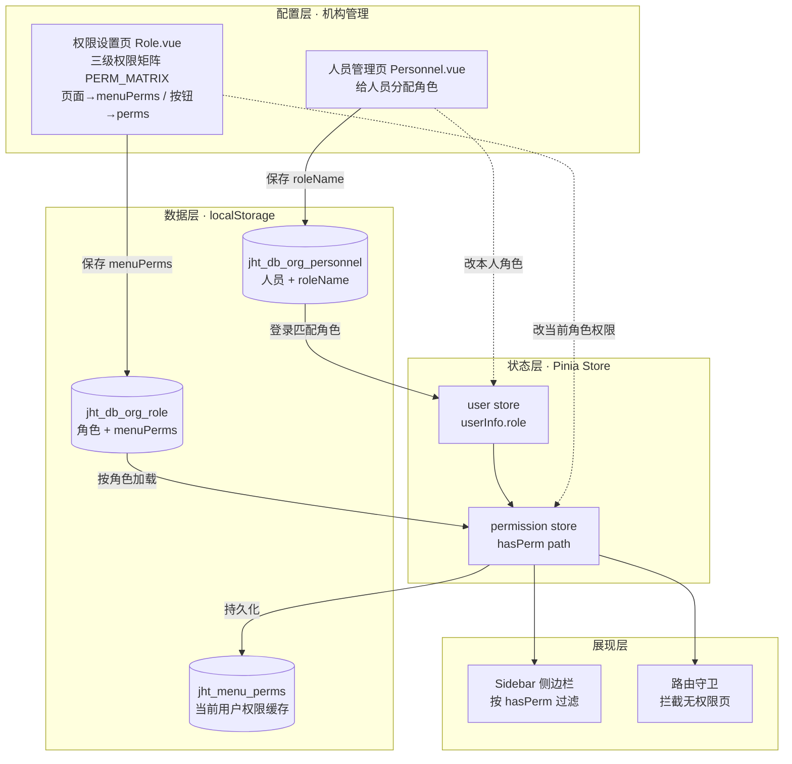
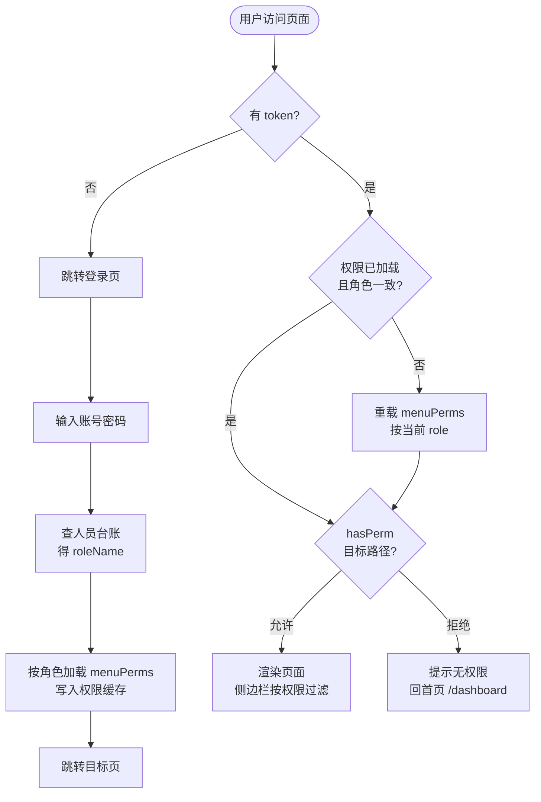
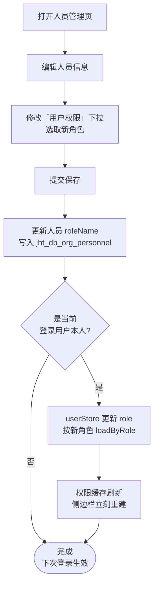

# 角色菜单权限 · 产品需求文档（PRD）

| 项目 | 内容 |
| --- | --- |
| 模块 | 机构管理 - 权限设置 / 人员管理 |
| 版本 | v1.1 |
| 类型 | 原型阶段（纯前端 mock，localStorage 持久化，无后端） |
| 关联文档 | [migration.md](../migration.md) 第九节（登录菜单过滤）、第十节 10.2（权限矩阵重建） |

> **v1.1 变更**：权限设置页由「两级菜单树勾选」重建为原项目的「三级权限矩阵」（模块 → 页面〔菜单页面 / 操作权限两栏〕→ 按钮）。登录菜单过滤逻辑不变，页面勾选仍写 `menuPerms`；新增按钮级 `perms`。详见 §3.1、§四、§8.2。

## 一、背景与目标

系统菜单达 11 个模块、130+ 页面，不同岗位（运营、客服、财务、代理商等）
只需使用其中一部分。若所有登录用户都看到全部菜单，既不安全也不易用。

**目标**：后台可视化配置「每个角色能看哪些菜单/页面」，用户登录后
仅展示其角色被授权的菜单，未授权页面即使手动输入地址也无法访问。

**设计原则**
- 可配置：权限由后台勾选，非硬编码在代码里。
- 默认拒绝：角色未配置或为空，则除首页外不可见任何页面。
- 本地持久化：配置与用户权限存 localStorage，刷新/重启不丢。
- 即时生效：改角色权限或改用户角色，当前会话立即刷新，无需重登。

## 二、名词定义

| 名词 | 含义 |
| --- | --- |
| 角色 Role | 一组菜单权限的集合，如「客服专员」。含 `menuPerms` 字段。 |
| menuPerms | 该角色可见页面的完整 path 数组。`['*']` = 全部；`[]` = 仅首页。 |
| 菜单树 MENU_TREE | 模块 → 叶子页面 的两级结构，供勾选配置，路径与路由一致。 |
| 超级管理员 | 内置最高权限角色，恒定 `['*']`，不受任何配置影响。 |
| 人员 | 登录账号，通过 `roleName` 关联到某个角色。 |

## 三、功能需求

### 3.1 角色权限配置（权限设置页 · 三级权限矩阵）
- 左侧角色列表，支持新增/编辑/删除角色。
- 右侧为**三级权限矩阵**（由 `MENU_TREE` 派生的 `PERM_MATRIX`）：
  - **一级 模块**：如「机构管理 / 订单管理」，可折叠。
  - **二级 页面**：每个页面一行，分「**菜单页面**」与「**操作权限**」两栏。勾选「菜单页面」= 授予该页访问权（写入 `menuPerms`，驱动登录菜单过滤）。
  - **三级 按钮**：每个页面下的操作按钮（查看/新增/编辑/删除/导出），勾选写入 `perms`（操作级权限）。
- 级联勾选：勾页面自动带出其按钮；全选/清空一键操作。
- 提供「全选 / 清空 / 保存权限」。
- 超级管理员显示「默认拥有全部权限」提示，不可编辑。
- 保存后：页面勾选 → `menuPerms`（仅叶子 path），按钮勾选 → `perms`（按钮 id）。

### 3.2 人员角色分配（人员管理页）
- 新增/编辑人员时，「用户权限」下拉取自角色列表（同一数据源）。
- 一个人员绑定一个角色，其可见菜单由该角色决定。

### 3.3 登录与鉴权
- 登录按用户名匹配人员台账得 `roleName`（admin 固定超管）。
- 登录后按角色加载 `menuPerms` 并缓存。
- 侧边栏仅渲染有权限的菜单；模块下无可见页面则整块隐藏。
- 路由守卫拦截无权限页面 → 回首页并提示「无该页面访问权限」。
- 隐藏子页（如录单）按 `activeMenu` 归属其列表页判定权限。

### 3.4 即时刷新
- 在权限设置页改「当前登录用户所属角色」的权限 → 侧边栏立即刷新。
- 在人员管理页改「当前登录用户本人」的角色 → 立即按新角色重载权限。
- 缓存的角色与当前用户角色不一致时，自动重载（防旧缓存越权）。

## 四、数据模型

**角色记录**（localStorage: `jht_db_org_role`）
```js
{
  id, name, custType,
  menuPerms: ['/orderlist/whole-order', ...], // 页面访问权（驱动登录菜单过滤）
  perms: ['/orderlist/whole-order:view', ...], // 按钮操作权（页面 path + ':' + 动作 key）
  remark, createTime
}
```

**权限矩阵派生常量**（`organizers.js`，由 `MENU_TREE` 派生，供配置界面渲染与全选）
```js
PERM_MATRIX     // 模块 → 页面 → 按钮(查看/新增/编辑/删除/导出) 三级结构
ALL_MENU_PATHS  // 全部页面 path（页面全选用）
ALL_PERM_IDS    // 全部按钮 id（按钮全选用）
```

**权限缓存**（localStorage: `jht_menu_perms`）
```js
{ role: '客服专员', perms: ['/orderlist/whole-order', ...] }
```

**用户信息**（localStorage: `userInfo`）
```js
{ username, name, role: '客服专员' }
```

## 五、权限判定规则

| 场景 | menuPerms | 结果 |
| --- | --- | --- |
| 超级管理员 | 忽略配置 | 全部放行（硬编码 `['*']`） |
| 普通角色配置了页面 | `['/a','/b']` | 仅这些页面 + 首页可见 |
| 角色未配置 / 空 | `[]` | 仅首页可见（默认拒绝） |
| 任意角色 | — | `/dashboard` 恒可访问 |
| 权限未加载（守卫竞态） | `null` | 暂不拦截，加载后再判 |

## 六、默认角色（演示数据）

| 账号 | 角色 | 可见范围 |
| --- | --- | --- |
| admin | 超级管理员 | 全部菜单 |
| user05 | 运营主管 | 订单/运营/仓库部分页面 |
| user02 | 客服专员 | 全程订单、订单签收、代客下单、客户管理 |
| user03 | 财务专员 | 财务管理主要页面 |
| user04 | 代理商管理员 | 全程订单、订舱订单、订舱价格 |

## 七、结构图（模块与数据流）



## 八、流程图

### 8.1 登录鉴权流程



### 8.2 角色权限配置流程

```mermaid
flowchart TD
  Open[打开权限设置页] --> LoadRoles[加载角色列表]
  LoadRoles --> SelectRole[点击选择角色]
  SelectRole --> IsSuper{是超级管理员?}
  IsSuper -- 是 --> ShowTip[显示「默认全部权限」\n树不可编辑]
  IsSuper -- 否 --> ShowTree[展示三级权限矩阵 PERM_MATRIX\n恢复已勾选 menuPerms/perms]
  ShowTree --> Edit[勾选/取消\n页面(菜单页面栏) + 按钮]
  Edit --> Save[点击保存权限]
  Save --> PersistRole[更新角色 menuPerms + perms\n写入 jht_db_org_role]
  PersistRole --> IsSelf{改的是当前\n登录用户的角色?}
  IsSelf -- 是 --> SyncStore[permission store\n即时更新\n侧边栏立刻变化]
  IsSelf -- 否 --> Done([完成])
  SyncStore --> Done
```

### 8.3 人员角色变更流程



## 九、关键约束与注意事项

1. **数据孤岛**：角色直接存 localStorage，无后端同步。多标签页、跨浏览器数据相互独立，连接真实后端时需替换为 API 调用。

2. **单角色模型**：一个人员只能绑定一个角色（最简设计）。如需多角色合并权限，`hasPerm` 改为对多个角色的 `menuPerms` 求并集即可。

3. **超级管理员不可降级**：代码层硬编码，角色配置页和 `loadByRole` 均绕过配置。若业务需要，需显式移除该硬限制。

4. **旧缓存迁移**：`organizers.js` 模块加载时自动执行一次迁移（`menuPerms` 缺失则按角色名补默认值）；`permission store` 识别旧版缓存格式并触发重载，升级无感。

5. **默认拒绝原则**：角色的 `menuPerms` 未配置或为空数组，用户只能看到 `/dashboard`，其他所有页面被路由守卫拦截。

6. **`perms`（按钮权限）当前仅配置未拦截**：权限矩阵可勾选并持久化按钮级 `perms`，但页面内按钮尚未接入按需隐藏/禁用（登录菜单过滤只依赖 `menuPerms`）。后续如需按钮级管控，可在页面用 `perms.includes('/path:edit')` 控制按钮显隐。这与原项目 `v-permission` 指令对应。

7. **权限矩阵不含「权限点 CRUD / 请求接口 / 请求方式」**：原项目那套属后端权限节点管理，纯前端 mock 下无意义，故权限矩阵只保留「菜单页面 + 按钮」两类勾选。

## 十、相关源文件索引

| 文件 | 职责 |
| --- | --- |
| `src/store/permission.js` | 权限 Pinia Store：加载/缓存/校验 |
| `src/store/user.js` | 用户 Store：登录后加载权限，角色变更时同步 |
| `src/api/modules/organizers.js` | 角色数据 + MENU_TREE + PERM_MATRIX/ALL_MENU_PATHS/ALL_PERM_IDS + 旧数据迁移 |
| `src/api/modules/auth.js` | 登录 mock：按账号查角色 |
| `src/router/index.js` | 路由守卫：ensurePerms + hasPerm 拦截 |
| `src/components/Layout/Sidebar.vue` | 按 hasPerm 过滤渲染菜单 |
| `src/views/organizers/Role.vue` | 三级权限矩阵配置 UI（页面 menuPerms + 按钮 perms） |
| `src/views/organizers/Personnel.vue` | 人员角色分配 + 即时同步 |
